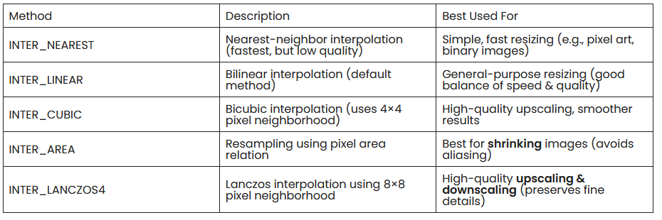
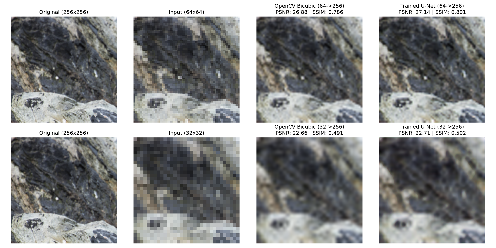
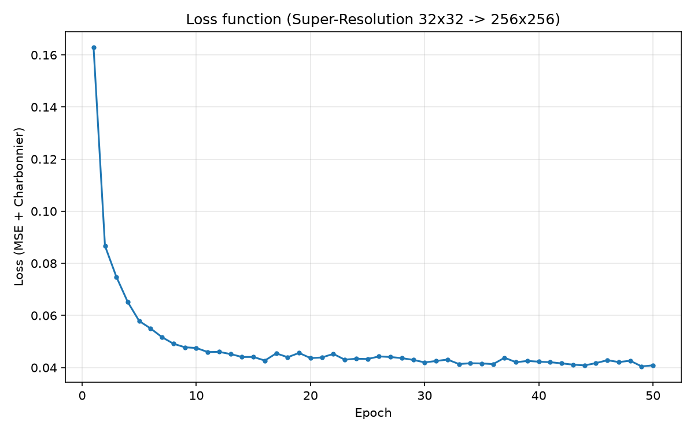
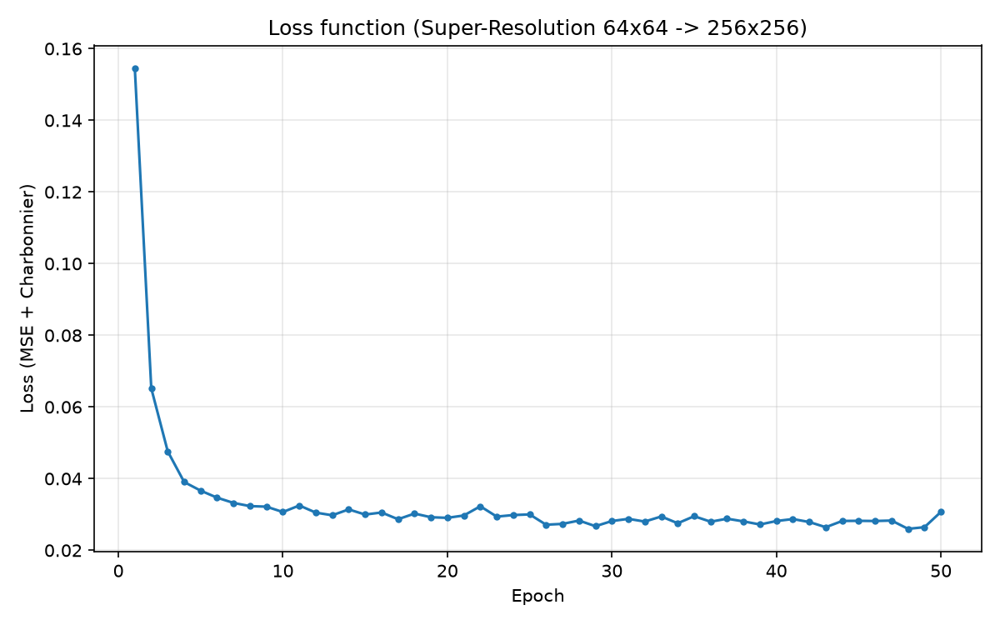

# Zadanie 2.1 - Zwiększanie rozdzielczości

## Przygotowanie zbioru danych i interpolacja

Obrazy wejściowe o wymiarach `256 × 256` ze zbioru DIV2K są zmniejszane do rozdzielczości `32 × 32` oraz `64 × 64` za pomocą funkcji `cv2.resize` z biblioteki OpenCV (kod w `src/ResolutionScaler.py`).

### Użyte metody interpolacji

Dostępne metody interpolacji w cv2:



1. **Zmniejszanie rozdzielczości**
   - Zastosowano interpolację powierzchniową **`cv2.INTER_AREA`** (resampling wykorzystujący relację powierzchni pikseli).
   - Jest to metoda zalecana w dokumentacji OpenCV do pomniejszania obrazów, ponieważ uśrednia wartości pikseli z całego obszaru źródłowego i zapobiega powstawaniu artefaktów aliasingu.
2. **Metoda bazowa**
   - Zgodnie z poleceniem zastosowano funkcję `cv2.resize` z interpolacją bikubiczną **`cv2.INTER_CUBIC`.**

## Wyniki

### Wizualizacja



### Metryki

```
Method                                   |        SNE |     PSNR |     SSIM |    LPIPS
--------------------------------------------------------------------------------------
opencv_bicubic_resize_32_x_32            |    1181.85 |  27.2031 |   0.6710 |   0.4815
unet_super_resolution_32_x_32            |    1174.87 |  26.1184 |   0.6660 |   0.4512
opencv_bicubic_resize_64_x_64            |     611.29 |  30.3063 |   0.8109 |   0.3145
unet_super_resolution_64_x_64            |     592.41 |  29.7087 |   0.8135 |   0.2964
```

### Funkcje straty




