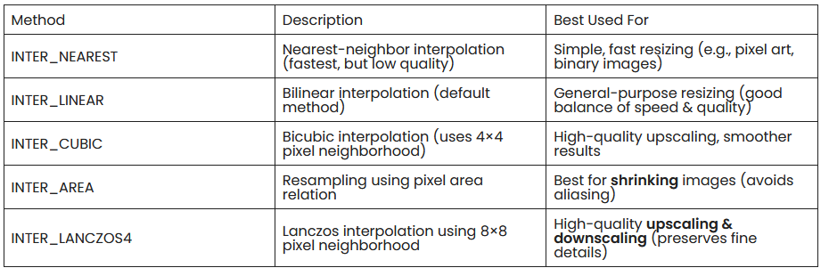

# Zadanie 2.1 – Zwiększanie rozdzielczości

## Przygotowanie zbioru danych i interpolacja

Obrazy wejściowe o wymiarach `256 × 256` ze zbioru DIV2K są zmniejszane do rozdzielczości `32 × 32` oraz `64 × 64` za pomocą funkcji `cv2.resize` z biblioteki OpenCV (kod w `src/ResolutionScaler.py`).

### Użyte metody interpolacji

Dostępne metody interpolacji w cv2:

1. **Zmniejszanie rozdzielczości**
   - Zastosowano interpolację powierzchniową **`cv2.INTER_AREA`** (resampling wykorzystujący relację powierzchni pikseli).
   - Jest to metoda zalecana w dokumentacji OpenCV do pomniejszania obrazów, ponieważ uśrednia wartości pikseli z całego obszaru źródłowego i zapobiega powstawaniu artefaktów aliasingu.
2. **Metoda bazowa**
   - Zgodnie z poleceniem zastosowano funkcję `cv2.resize` z interpolacją bikubiczną **`cv2.INTER_CUBIC`.**
