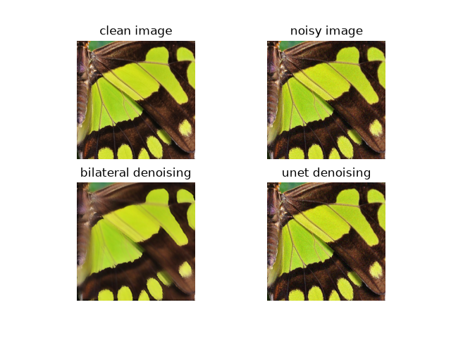
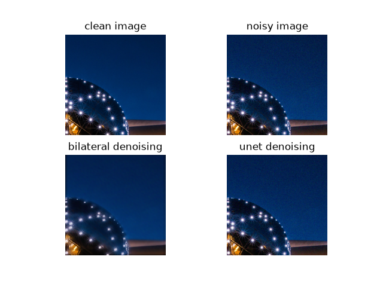

# Zadanie 2.1 - Odszumioanie 

## Przygotowanie zbioru danych i interpolacja

Obrazy wejściowe ze zbioru DIV2K/DIV2K_train_LR_bicubic/X2/ o zmiejszonej rodzielczości są cięte na fragmenty o wielkości 256x256 podczas inicjacji klasy ImageDataset. Przy dostępie do obrazów z zainicjkjowanego datasetu zwracane sa 2 kopie, oryginalna i z dodanym szumem gaussowskim. 
Szum nakładany jest przez operacje:
```
noise = torch.randn_like(image) * self.noise_stddev
image_noise = (image + noise).clamp(0.0, 1.0)
```

### Użyte metody odszumiania

1. **Model odszumiający**
    - Stwożono model Unet przewidujący szum na obrazie wejściowycm
    - Podczas trenmingu otrzymany szum porównywany jest z różnicą między obrazem zaszumionym a oryginalnym.
    - Jako funkcję straty wykorzystano błąd średniokwadratowy. Uzyta zosyała funkcja torch.nn.MSELoss
    - Podczas walidacji od obrazu zaszumionego odejmowany jest przewidziany przez model szum 
    - W ramach eksperymentów metoda przewidywania szumu okazała się skuteczniejsza od przewidywania obrazu oryginalnego.
    - Złożone funkcje starty nie dają lepszego wyniku od MSE dla nieskomplikowanego modelu.

2. **Model bazowy**
Jako model bazowy usuwania szumów posłużyła funkcja skimage.restoration.denoise_bilateral. 

Została ona obudowana funkcją obługuącą dane wsadowe otzrymane z datasetu:
```
def bilateral_denoise_batch(self, images, sigma_color=0.1, sigma_spatial=2):
        device =torch.device("cuda:0" if torch.cuda.is_available() else "cpu")
        dtype = images.dtype

        images_np = images.detach().permute(0, 2, 3, 1).cpu().numpy()
        denoised = np.stack([
            denoise_bilateral(
                img,
                sigma_color=sigma_color,
                sigma_spatial=sigma_spatial,
                channel_axis=-1,
            )
            for img in images_np
        ])
        return torch.from_numpy(
            denoised.transpose(0, 3, 1, 2).copy()
        ).to(device=device, dtype=dtype)
```


## Wyniki

### Wizualizacja





### Metryki

```
model                                     PSNR      SSIM    LPIPS(vgg)
-------------------------------------  -------  --------  ------------
no model                               30.6226  0.769748      0.209552
skimage.restoration.denoise_bilateral  26.0828  0.726742      0.32353
Unet (MSE loss)                        30.6331  0.770835      0.209507
Unet (DCNN loss)                       7.45029  0.0743994     0.609495
```

**Wagi dla funkcji starty dcnn**
```total_loss = 0.8*MSE + 0.2*charbonnier_loss + 0.05 * perceptual_loss ```
