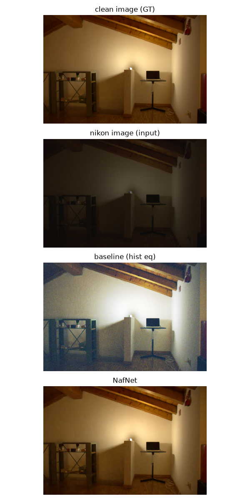
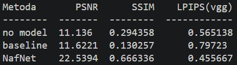
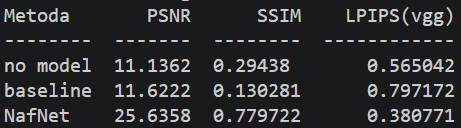

# Low light image enhancement

## Architektura i przygotowanie danych

Korzystamy z sieci NafNet z połączeniem rezydualnym. Porównawczą metodą baseline jest `torchvision.transforms.functional.equalize`, która wyrównuje histogram jasności obrazu.

Zbiór danych to pierwsze 100 zdjęć wnętrz z datasetu RAISE (Nikon D7000) w formacie `.NEF`:

- 80 zdjęć do treningu: są cięte na kawałki 256x256 dla oszczędności VRAM i powiększenia liczebności próbek,
- 20 zdjęć do walidacji: ewaluacja odbywa się na pełnych obrazach (2464x1632 po `half_size=True`).

Jak w fizycznym modelu matrycy, obrazy wejściowe powstają przez odczyt obrazu w przestrzeni liniowej, obniżenie ekspozycji o -3 EV, dodanie szumu Poissona i Gaussa, na końcu nałożenie korekcji gamma i kwantyzację do 8 bitów.

## Uruchomienie

Pobranie 100 obrazów ze zbioru RAISE:

```bash
uv run main.py -d
```

Trening modelu na GPU wraz z walidacją i zapisem wyników:

```bash
uv run main.py --gpu
```

## Wyniki

### Wizualizacja

### Pierwsze podejście

Funkcja straty to po prostu L1.



Sieć NafNet już teraz radzi sobie dużo lepiej od metody bazowej: PSNR rośnie z 11.62 dB do 22.54 dB, a SSIM z 0.130 do 0.666.

### Drugie podejście

W funkcji straty dodaliśmy składową z SSIM (i clamp do zakresu wartości [0, 1]), przez co sieć lepiej zachowuje lokalny kontrast i ostrość krawędzi.

Pod koniec treningu zastosowaliśmy wygaszanie learning rate (od `1e-3` do `1e-5`).

Wycinki treningowe podawane w grupach po 10 pochodzą z losowo wybranych zdjęć, a nie z tylko jednego, co ujednolica gradienty między kolejnymi krokami optymalizatora.



## Analiza wyników

- Choć metoda baseline (wyrównanie histogramu) lekko poprawia PSNR względem ciemnego wejścia, to psuje metryki SSIM i LPIPS. Wynika to z faktu, że wyrównanie histogramu mocno podbija szum Poissona/Gaussa w ciemnych partiach obrazu, co najbardziej widać na gładkich powierzchniach, które stają się kolorowe i niejednolite.
- W metodzie baseline wyrównywanie histogramu odbywa się osobno dla kanałów R, G i B, co prowadzi do nienaturalnych przebarwień i utraty oryginalnego balansu bieli. Sieć NafNet przetwarza wszystkie kanały naraz i poprawnie odtwarza kolorystykę sceny.
- Na zdjęciach wnętrz z punktowymi źródłami światła metoda baseline rozciąga kontrast i powoduje utratę przejść tonalnych wokół jasnych obszarów. Sieć NafNet działa lokalnie, więc rozjaśnia cienie bez przepalania jasnych partii obrazu.
- Ograniczenia metryk (PSNR oraz LPIPS):
  - Obraz GT korzysta z automatycznego rozciągania jasności (dobierany globalny mnożnik ekspozycji dla każdego zdjęcia na podstawie jego histogramu), podczas gdy obraz wejściowy generowany jest bez takowego. Przez to odszumiony obraz z sieci może różnić się globalną jasnością od GT, co obniża maksymalny możliwy do uzyskania wynik PSNR.
  - Tradeoff percepcja-znikształcenie: po osłabieniu sygnału 8 razy i nałożeniu szumu, w cieniach najdrobniejsze tekstury znajdują się poniżej poziomu szumu. Sieć w takich miejscach wygładza powierzchnię żeby poprawić PSNR, ale to z kolei pogarsza LPIPS, które faworyzuje wyostrzone detale.
